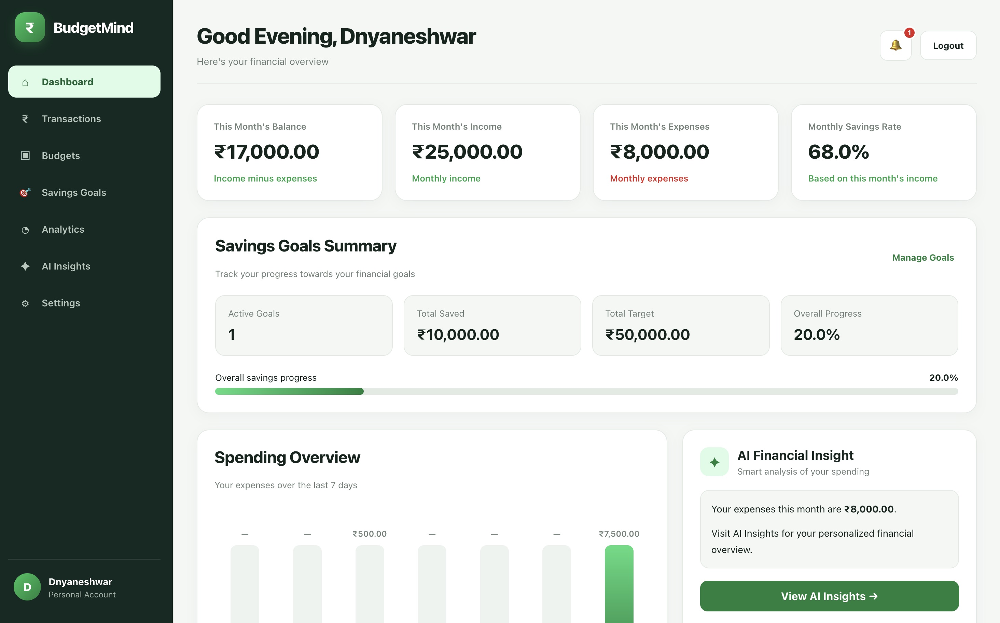
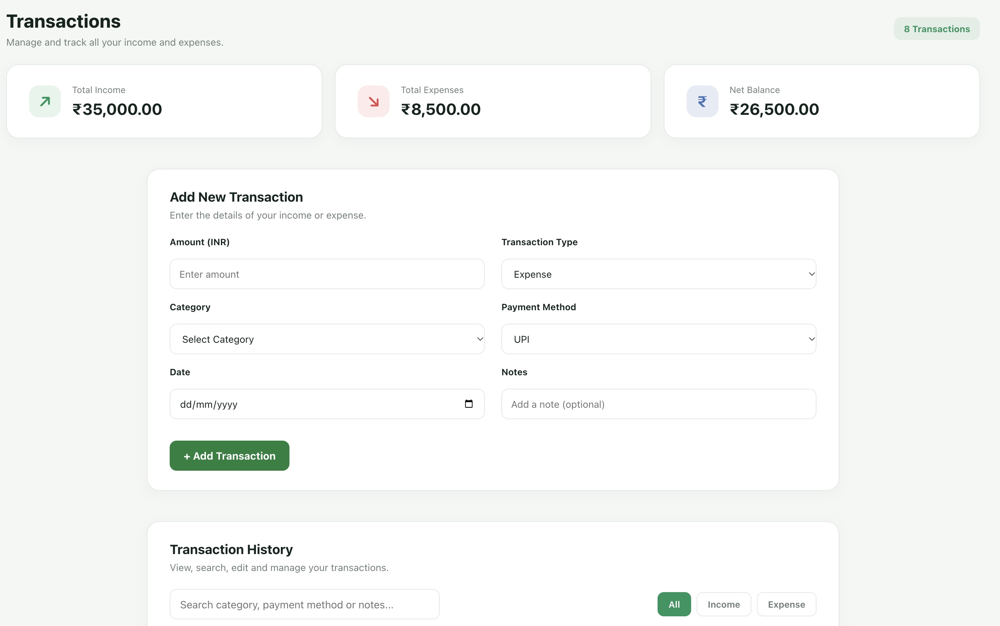
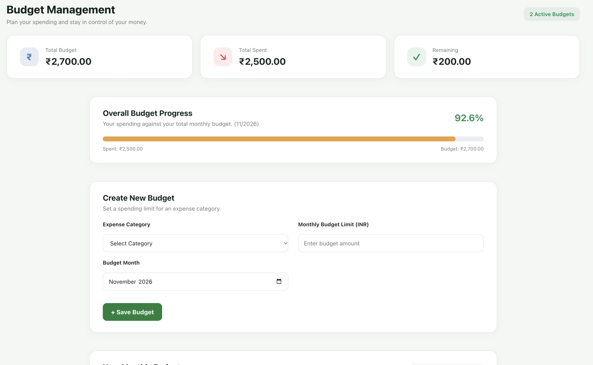
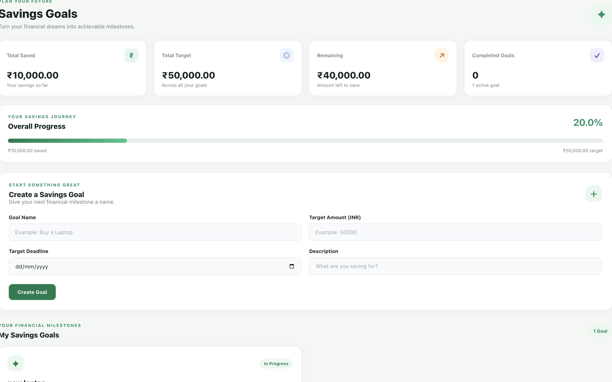
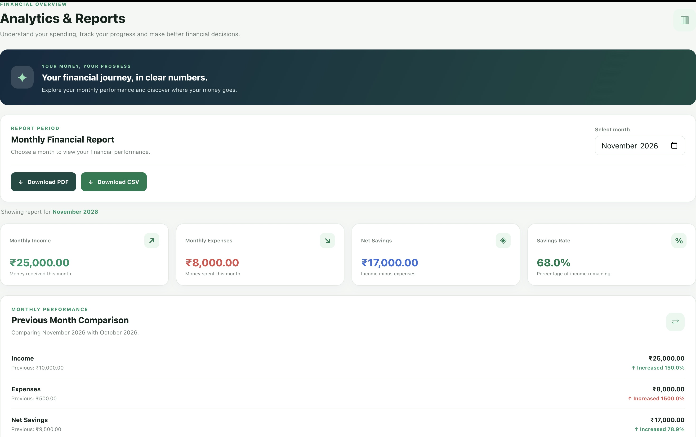
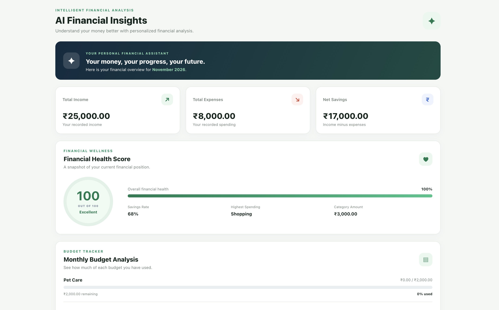
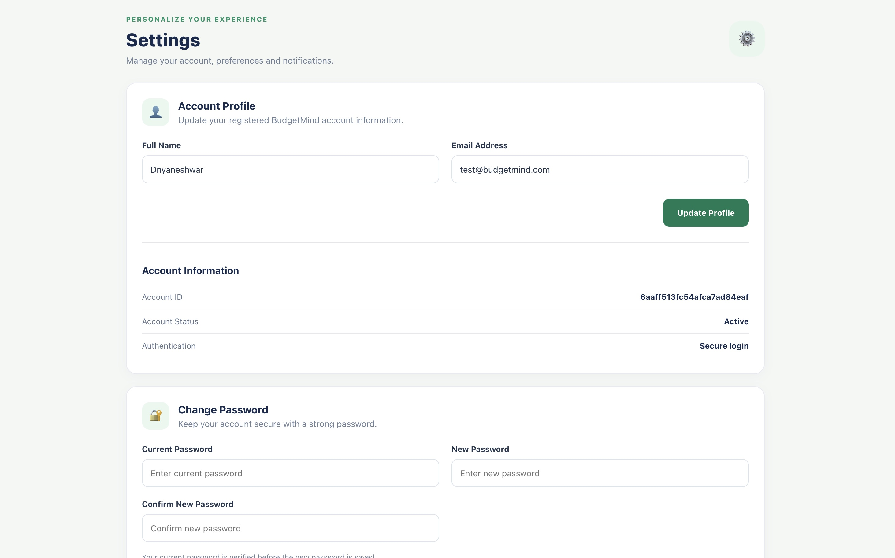

# BudgetMind — AI-Powered Personal Finance Tracker

BudgetMind is a full-stack personal finance management application designed to help students and early-career professionals track expenses, manage budgets, monitor savings goals, and understand their spending habits.

## Features

- User registration, login, and account management
- Add, edit, and delete income and expense transactions
- Manage monthly budgets and custom categories
- Create and track savings goals
- AI-powered financial insights and spending alerts
- Monthly analytics and spending comparisons
- Dashboard with financial summaries and charts
- Export financial reports in PDF and CSV formats
- Light and dark themes
- Currency and date format preferences
- Responsive user interface

## Technology Stack

**Frontend**
- React.js
- Vite
- CSS

**Backend**
- Node.js
- Express.js
- REST API
- JWT Authentication
- bcryptjs

**Database**
- MongoDB
- Mongoose

## Project Structure

```text
BudgetMind/
├── backend/
│   ├── controllers/
│   ├── middleware/
│   ├── models/
│   ├── routes/
│   └── server.js
├── frontend/
│   ├── public/
│   └── src/
├── .gitignore
└── README.md
```

## Getting Started

### Prerequisites

- Node.js and npm
- MongoDB Atlas account or MongoDB instance
- Git

### 1. Clone the repository

```bash
git clone https://github.com/patlednyaneshwar91-cloud/BudgetMind.git
cd BudgetMind
```

### 2. Install backend dependencies

```bash
cd backend
npm install
```

Configure your backend environment variables in a local `.env` file using the variable names required by your backend code.

### 3. Start the backend

```bash
npm start
```

### 4. Install frontend dependencies

Open another terminal:

```bash
cd BudgetMind/frontend
npm install
```

### 5. Start the frontend

```bash
npm run dev
```

Open the local URL displayed by Vite in your browser.

## Screenshots

Screenshots of the dashboard, transactions, budgets, analytics, and AI insights will be added here.

## Future Improvements

- Enhanced financial analytics
- More intelligent spending recommendations
- Additional security and deployment improvements

## Author

**Dnyaneshwar Patle**

GitHub: [patlednyaneshwar91-cloud](https://github.com/patlednyaneshwar91-cloud)

## License

License information will be added later.

## 📸 Project Screenshots

### Dashboard


### Transactions


### Budgets


### Savings Goals


### Analytics


### AI Insights


### Settings



